# SusuFlow

SusuFlow is a **multi-tenant digital susu operating system** for savings companies, field collectors, customers, and platform operators.

It digitizes collection so customers deposit **directly** via Mobile Money and card gateways. Funds never pass through collectors’ hands — eliminating skimming fraud — while collectors stay in the loop as cashless onboarding and assisted-deposit agents.

> Mission: every deposit is **gateway-confirmed**, **ledger-posted**, and **audit-trailed**.

---

## Product scope

### Operational capabilities

- Multi-tenant susu companies (subdomain / slug isolation, branding, subscriptions)
- Customer web portal + native Expo app (deposits, goals, passbook, support)
- Staff / company-admin portal (customers, deposits, GL, reconciliation, KYC, team)
- Collector portal (field onboarding, assisted MoMo deposits, geofence, commissions)
- Super-admin portal (tenants, platform ops, global KYC authority)
- Double-entry ledger with immutable `ledger_entries` and derived balances
- Payment rails: Hubtel (MoMo) and Paystack (cards), webhook-driven settlement
- Notifications, receipts, fraud alerts, audit logs, MFA for privileged roles

### Current boundaries (honest product posture)

| Boundary | Current reality |
|----------|-----------------|
| Cash collection | Collectors **do not** handle customer cash for SusuFlow deposits |
| Balance source of truth | Wallet balances are **derived from ledger entries**, not mutable balance columns alone |
| Payment confirmation | Gateway / webhook is source of truth — UI “success” waits on verified settlement |
| Compliance | Controls and audit trails exist — they **do not replace** BoG / DPC legal certification |
| Open banking | Roadmap — not a live open-banking marketplace today |

Deep specs live under [`docs/`](docs/) (23 engineering documents).

---

## App preview

Customer mobile app (Expo) — dark banking chrome for deposits, goals, passbook, and support.

<p align="center">
  
  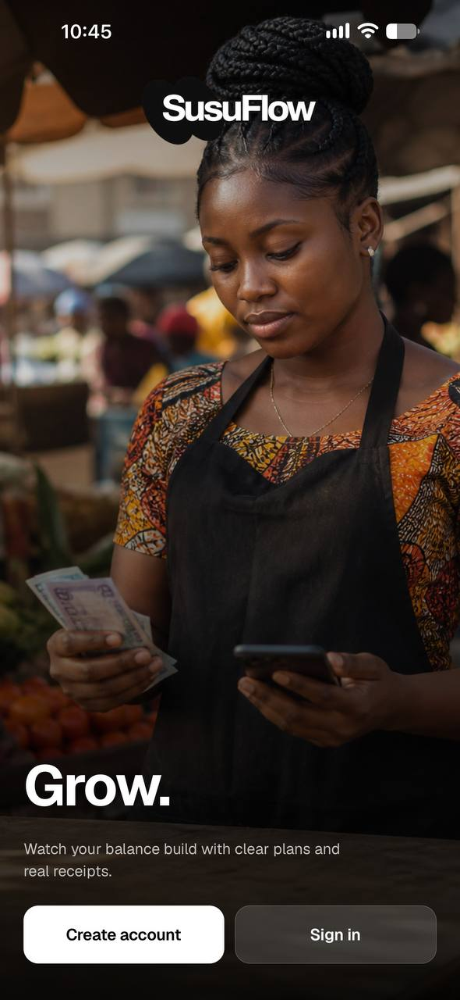
  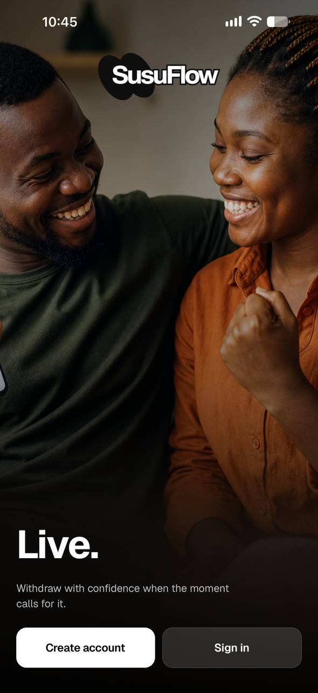
  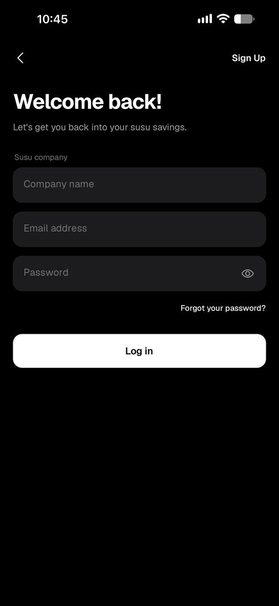
</p>

<p align="center">
  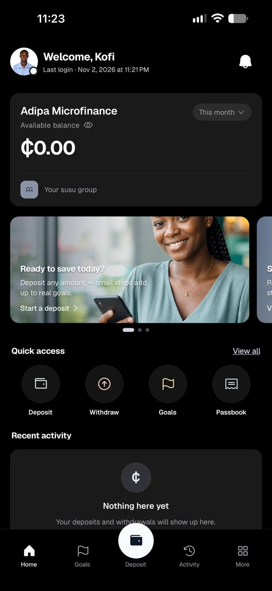
  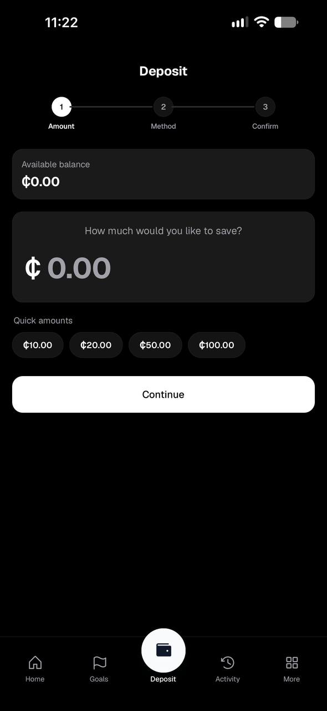
  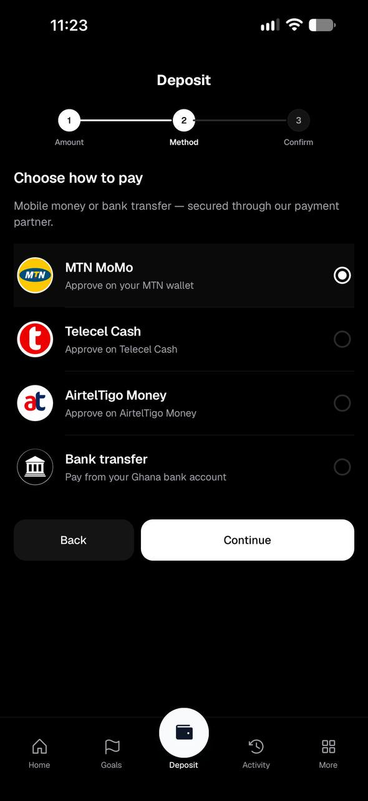
  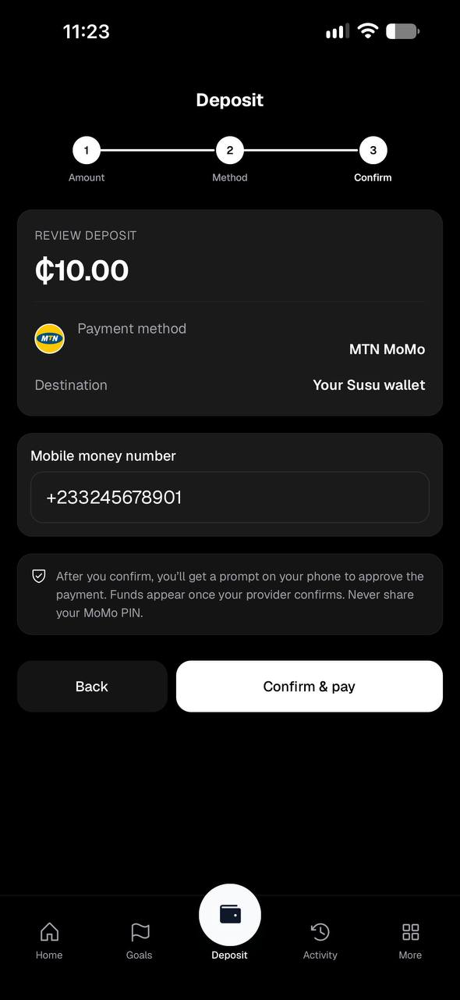
</p>

<p align="center">
  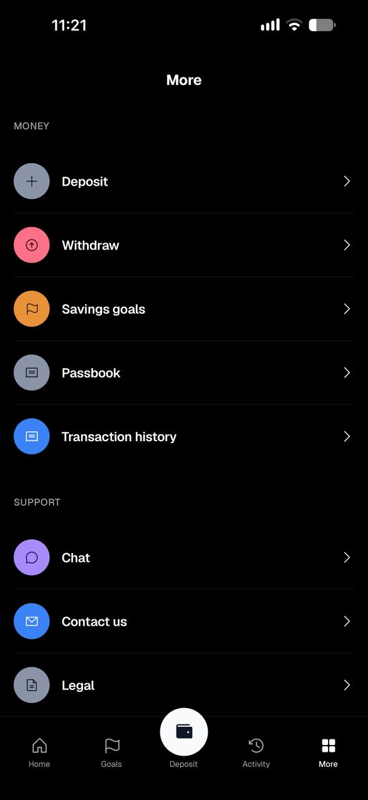
  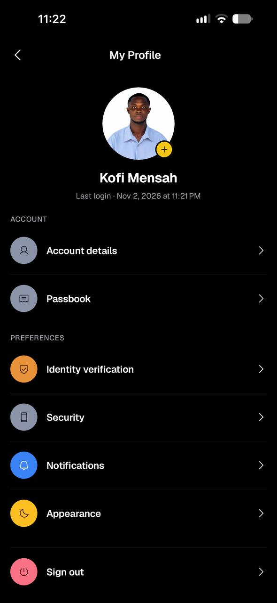
  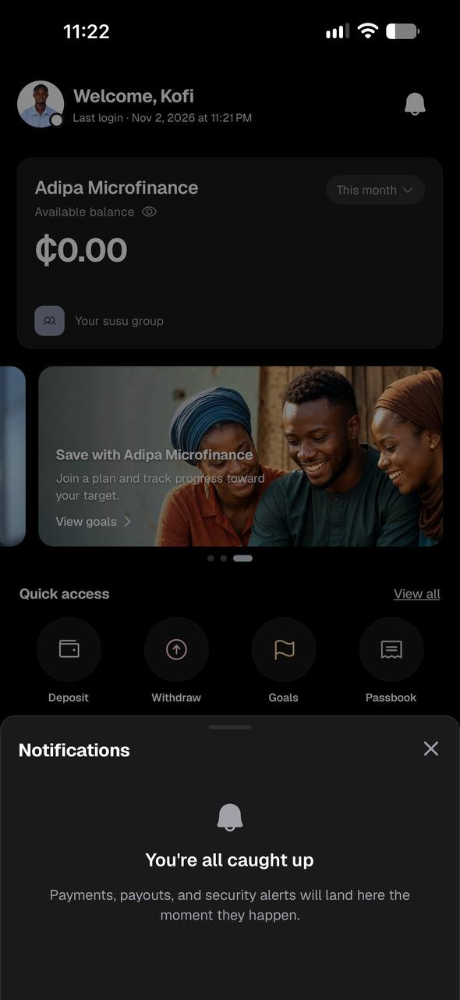
  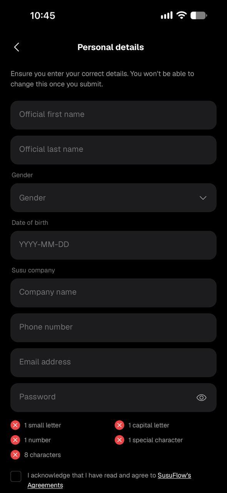
</p>

Full set: [`docs/screenshots/`](docs/screenshots/README.md)

---

## System architecture

### Context

Actors use role-specific Next.js portals or the Expo customer app. Clients call a versioned NestJS API over HTTPS. Domain modules persist to PostgreSQL (RLS), cache/queue on Redis + BullMQ workers, and settle money at payment gateways. Async side-effects (receipts, notifications, fraud, audit) run on workers.

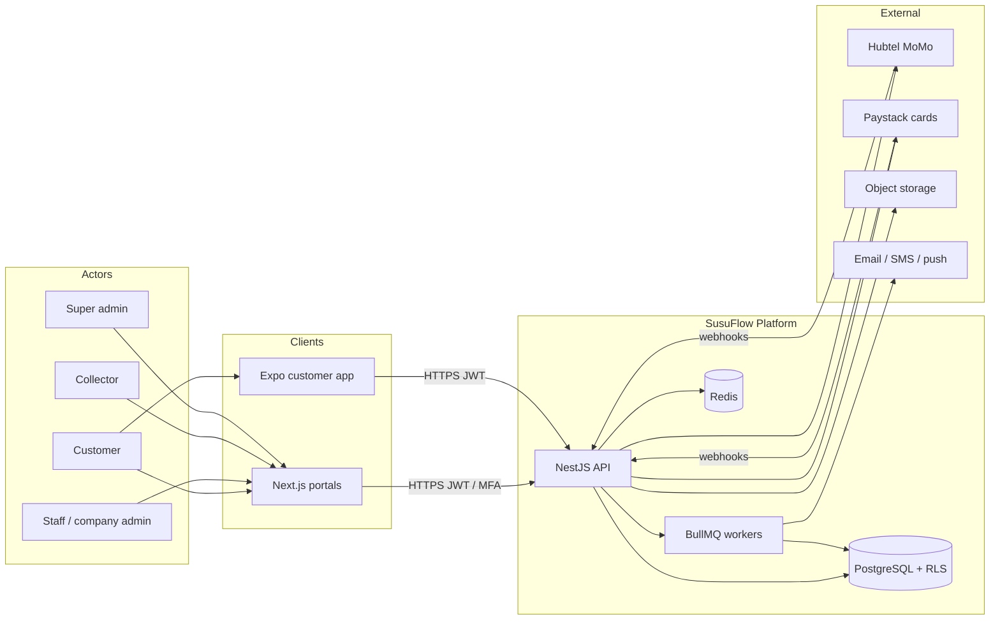

### Frontend ↔ backend request path

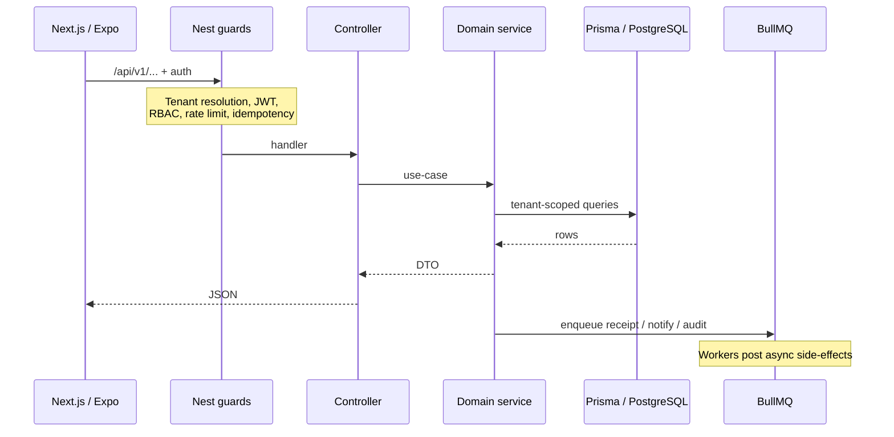

### Runtime stack

| Layer | Technology | Responsibility |
|-------|------------|----------------|
| Web | Next.js 15, React, TypeScript, Tailwind, ShadCN | Marketing + role portals |
| Mobile | Expo / React Native, Expo Router | Customer banking chrome |
| API | NestJS modular monolith | Versioned REST `/api/v1/*` |
| Workers | BullMQ on Redis | Receipts, notifications, fraud, audit |
| Persistence | PostgreSQL 16, Prisma, RLS | Tenant isolation + immutable ledger |
| Cache / queue | Redis | Sessions, rate limits, jobs |
| Payments | Hubtel, Paystack | MoMo + cards; webhook settlement |
| Infra | Docker, Terraform, GitHub Actions, EAS, Render / AWS | Build, deploy, mobile release |

### Repository structure

```text
apps/
  api/                  NestJS API (modules, guards, webhooks)
  web/                  Next.js App Router portals + marketing
  mobile/               Expo customer app
  worker/               BullMQ consumers
packages/
  database/             Prisma schema, migrations, seeds
  shared/               Cross-app types and constants
infrastructure/         Docker, Terraform, compose
docs/                   PRD → deploy → compliance dossier (23 specs)
.husky/                 commit-msg strip + commitlint, lint-staged
```

---

## Frontend design

### Portal layout

One web app, **role-routed portals**, plus public marketing and a separate native customer app.

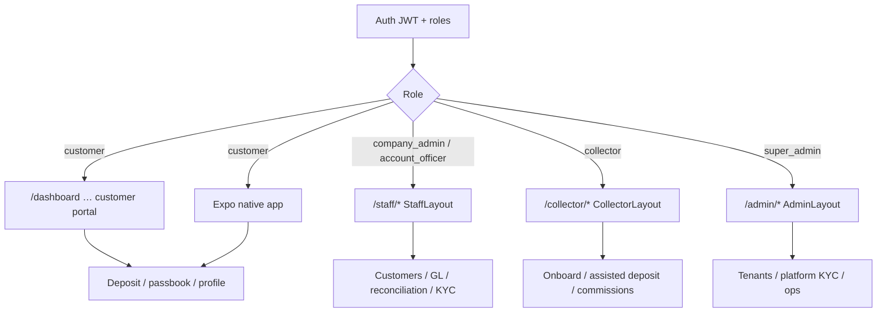

### Portal entry points

| Actor | Surface | Primary routes |
|-------|---------|----------------|
| Customer (web) | Next.js | `/dashboard`, `/deposit`, `/transactions`, `/profile` |
| Customer (native) | Expo | See [`apps/mobile/README.md`](apps/mobile/README.md) |
| Staff | Next.js | `/staff/dashboard`, `/staff/customers`, `/staff/deposits` |
| Collector | Next.js | `/collector/dashboard`, `/collector/customers`, `/collector/deposit` |
| Marketing | Next.js | `/`, `/about`, `/product/*`, `/why-susuflow/*` |
| Auth | Next.js | `/login`, `/register` (+ MFA for privileged roles) |

---

## Money movement (what actually works)

### Cashless deposit sequence

Gateway confirmation is mandatory. Collectors may assist initiation; they never custody funds.

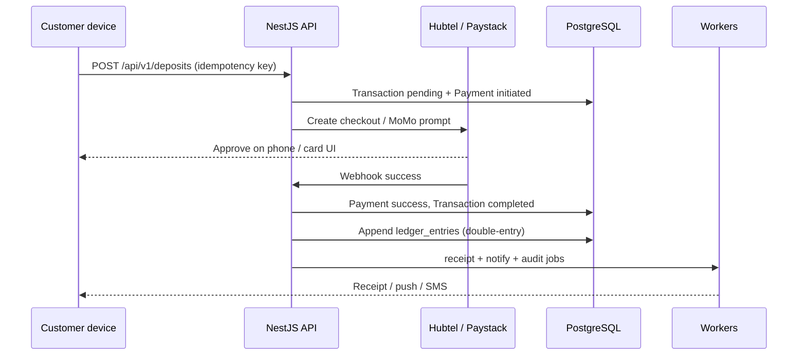

### Deposit lifecycle

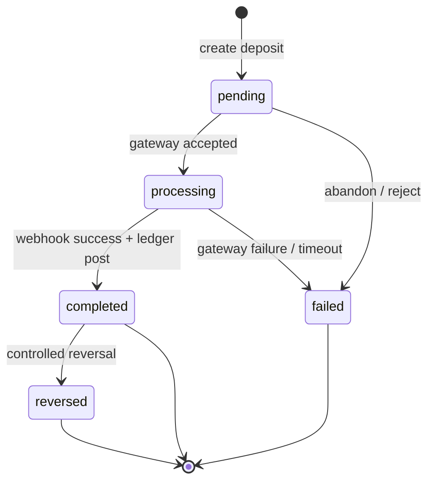

### Hybrid collector model

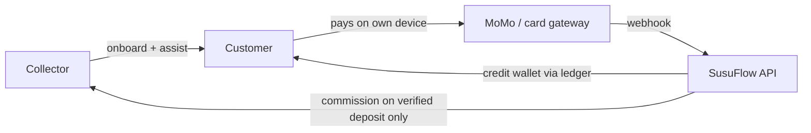

Collectors remain employed as **cashless agents**: onboard, assist MoMo, earn commission on **verified** deposits only — zero skim path.

### Withdrawal (high level)

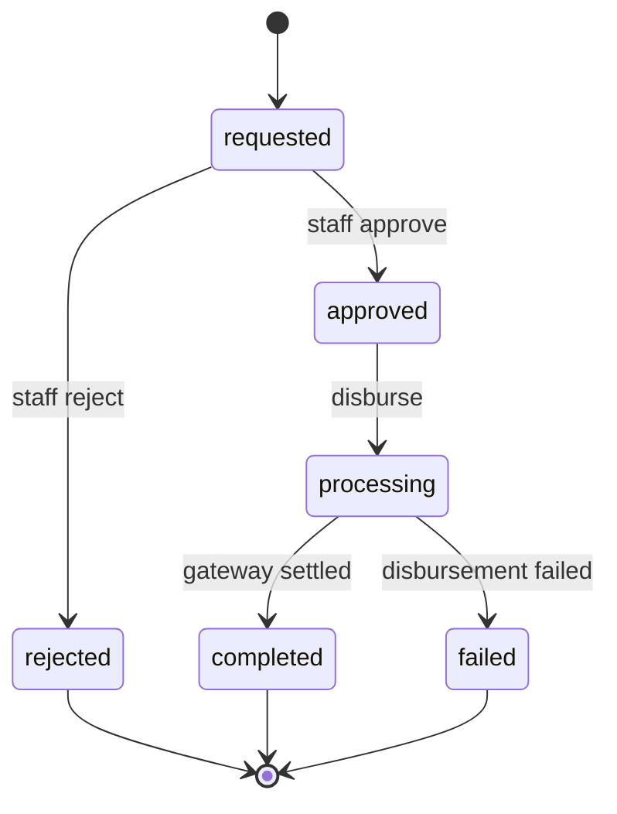

---

## Database design

### Principles

1. **UUID primary keys** — no sequential ID leakage across tenants  
2. **`tenant_id` on tenant-scoped tables** — enforced with PostgreSQL RLS  
3. **Immutable financial rows** — `ledger_entries` / `audit_logs` are append-only  
4. **Balances from ledger** — credits − debits, not trust-a-mutable-column  
5. **Idempotent money APIs** — deposits / withdrawals / webhooks safe to retry  

### Domain map

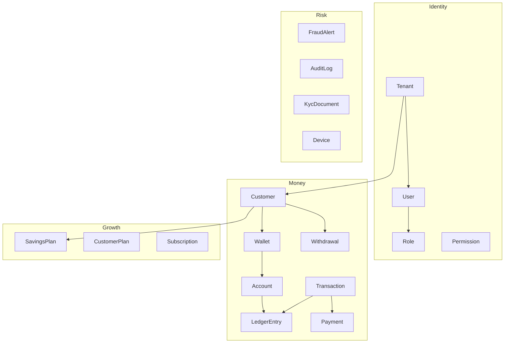

### Core entity relationships

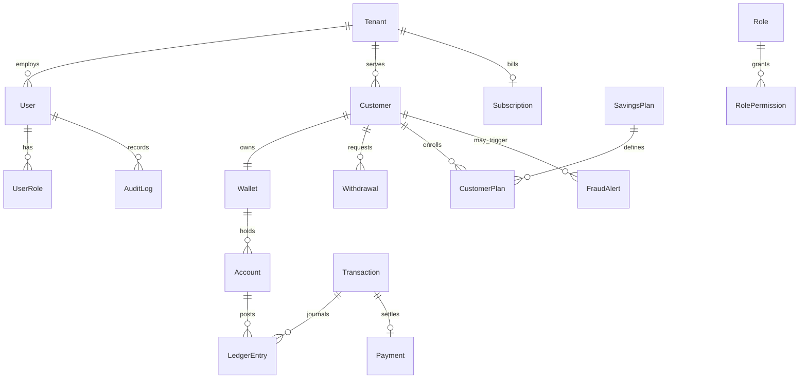

### Ledger posting (deposit example)

When a MoMo deposit of GH₵1,000 settles:

1. `Payment` → `success`  
2. `Transaction` → `completed`  
3. Append balanced `LedgerEntry` rows (debit clearing / credit customer liability)  
4. Enqueue receipt + notification + audit  

Balances are recomputed from verified entries — see [`docs/18-FINANCIAL_LEDGER_AND_DOUBLE_ENTRY_OPERATIONS_MANUAL.md`](docs/18-FINANCIAL_LEDGER_AND_DOUBLE_ENTRY_OPERATIONS_MANUAL.md).

---

## Key API surface

| Method | Endpoint | Description |
|--------|----------|-------------|
| POST | `/api/v1/auth/login` | Login |
| POST | `/api/v1/auth/register` | Customer registration |
| POST | `/api/v1/deposits` | Initiate deposit (idempotent) |
| POST | `/api/v1/withdrawals/request` | Customer withdrawal (idempotent) |
| POST | `/api/v1/webhooks/hubtel` | MoMo payment webhook |
| GET | `/api/v1/health` | Health check |

Swagger (local): http://localhost:4000/api/docs

---

## Local development

### Prerequisites

- Node.js 20+
- pnpm 9+
- Docker (PostgreSQL + Redis) — or the embedded Postgres helper scripts for local-only work

### Setup

```bash
pnpm install
cp .env.example .env
pnpm docker:up
pnpm db:generate
pnpm --filter @susuflow/database exec prisma db push
pnpm db:seed

pnpm --filter @susuflow/api dev
pnpm --filter @susuflow/worker dev
pnpm dev:web
pnpm dev:mobile          # Expo
pnpm dev:mobile:tunnel   # physical devices
```

App READMEs: [`apps/mobile`](apps/mobile/README.md) · [`apps/api`](apps/api/README.md) · [`apps/web`](apps/web/README.md)

---

## Documentation master index

| Phase | Document | Description | Status |
| :---- | :------- | :---------- | :----- |
| 1 | [PRD](docs/01-PRD.md) | Product requirements & flows | **Complete** |
| 2 | [BRD](docs/02-BRD.md) | Business / compliance / model | **Complete** |
| 3 | [System architecture](docs/03-system-architecture.md) | Modular monolith & ledger | **Complete** |
| 4 | [Database architecture](docs/04-database-architecture.md) | PostgreSQL, RLS, ledger tables | **Complete** |
| 5 | [API specifications](docs/05-api-specifications.md) | OpenAPI / REST | **Complete** |
| 6 | [UI/UX design](docs/06-ui-ux-design.md) | Design system & portals | **Complete** |
| 7 | [Folder structure](docs/07-folder-structure.md) | Monorepo layout | **Complete** |
| 8 | [Backend engineering](docs/08-BACKEND_ENGINEERING_AND_NESTJS_ARCHITECTURE.md) | NestJS, guards, BullMQ | **Complete** |
| 9 | [Frontend engineering](docs/09-FRONTEND_ENGINEERING_AND_NEXTJS_ARCHITECTURE.md) | Next.js App Router | **Complete** |
| 10 | [Testing](docs/10-testing.md) | Unit / integration / e2e | **Complete** |
| 11 | [Security audit](docs/11-security-audit.md) | Crypto, RBAC, PII | **Complete** |
| 12 | [Performance](docs/12-performance.md) | Cache, queues, query tuning | **Complete** |
| 13 | [CI/CD](docs/13-cicd.md) | GitHub Actions | **Complete** |
| 14 | [Deployment](docs/14-deployment.md) | Docker / K8s / EKS | **Complete** |
| 15 | [Load testing](docs/15-load-testing.md) | Concurrency & throughput | **Complete** |
| 16 | [Production readiness](docs/16-production-readiness.md) | Pre-flight & runbooks | **Complete** |
| 17 | [Regulatory dossier](docs/17-REGULATORY_COMPLIANCE_AND_AUDIT_SPECIFICATION.md) | BoG Act 987 / DPC Act 843 | **Complete** |
| 18 | [General ledger manual](docs/18-FINANCIAL_LEDGER_AND_DOUBLE_ENTRY_OPERATIONS_MANUAL.md) | COA & balance engine | **Complete** |
| 19 | [Geofence & offline](docs/19-FIELD_COLLECTOR_GEOFENCE_AND_OFFLINE_SYNC_GUIDE.md) | GPS & offline queue | **Complete** |
| 20 | [Operational runbook](docs/20-OPERATIONAL_RUNBOOK_AND_DISASTER_RECOVERY.md) | Incidents & DR | **Complete** |
| 21 | [Page-by-page guide](docs/21-PORTAL_AND_PAGE_BY_PAGE_USER_GUIDE.md) | Portal & native routes | **Complete** |
| 22 | [Render deploy](docs/22-RENDER_DEPLOYMENT_GUIDE.md) | `render.yaml` blueprint | **Complete** |
| 23 | [Mobile store readiness](docs/23-MOBILE_CUSTOMER_APP_AND_STORE_READINESS.md) | EAS, Sentry, submit gate | **Complete** |

### Diagram conventions

Architecture and lifecycle docs in this README use **Mermaid** (`flowchart`, `sequenceDiagram`, `stateDiagram-v2`, `erDiagram`) so diagrams render on GitHub and stay reviewable in PRs.

| Put diagrams here | Prefer prose / tables |
|-------------------|------------------------|
| System context, ER, RBAC | Feature checklists |
| Status machines / fund flows | Changelog-style notes |
| Deposit / webhook paths | One-off meeting notes |

When a PR changes a lifecycle or money rule, update the matching diagram in the same change.

---

## Roadmap

- **Phase 1:** Auth, tenants, customers, wallets, deposits, ledger, dashboards  
- **Phase 2:** Withdrawals, notifications, reports, KYC  
- **Phase 3:** Fraud detection, AI insights, advanced analytics  
- **Phase 4:** Enterprise features, open banking, API marketplace  

---

## License

Proprietary. All rights reserved.
